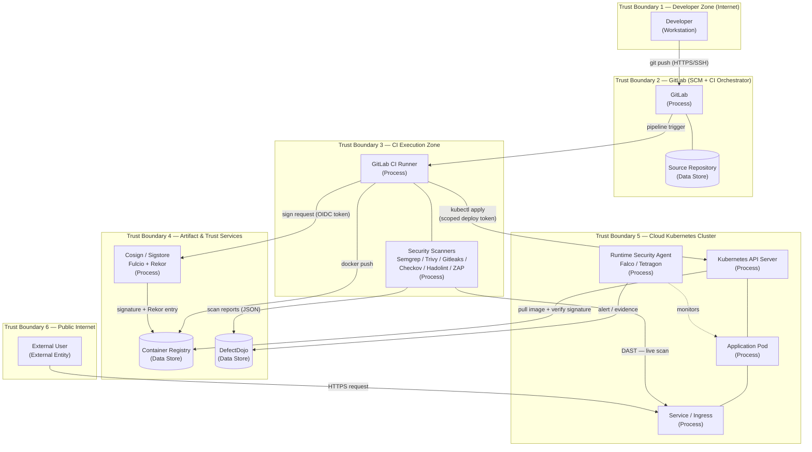

# Threat Model — Secure CI/CD to Cloud Kubernetes Capstone

Versiya: v0.1 (Phase 1) · Metodologiya: STRIDE + DFD · Status: Living document (hər fazada yenilənir)

---

## 1. Architecture Overview

Sistem aşağıdakı komponentlərdən ibarətdir:

| Komponent | Rol | Qeyd |
|---|---|---|
| Developer | Kod yazır, commit/push edir | Şəxsi workstation, GitLab hesabı |
| GitLab (SCM + CI orchestrator) | Source repo + pipeline orkestrasiyası | Protected branches, protected/masked CI variables |
| Source Repository | `.git` repo | `main` qorunan branch, MR tələb olunur |
| GitLab CI Runner | Pipeline job-larını icra edir | Docker executor, izolə edilmiş job-lar |
| Security Scanners | Semgrep, Trivy/Grype, Gitleaks, Checkov/Trivy-config, Hadolint, OWASP ZAP | CI job kimi işləyir, network-dən təcrid olunmuş |
| Container Registry | Build edilmiş image-ləri saxlayır | GitLab Container Registry, immutable tag+digest |
| Cosign / Sigstore | Image imzalama | Keyless (OIDC) imzalama, Rekor transparency log |
| DefectDojo | Mərkəzi finding store | Ayrı VM-də, Docker Compose |
| Kubernetes API Server | Cluster idarəetməsi | Cloud managed K8s (GKE/EKS/AKS class) |
| Application Pod | Runtime tətbiq konteyneri | Hardened securityContext |
| Service / Ingress | Şəbəkə giriş nöqtəsi | TLS terminasiya edilmiş |
| External User | Tətbiqi istifadə edən son istifadəçi | İctimai internet üzərindən |
| Runtime Security Agent | Falco/Tetragon | DaemonSet, syscall/eBPF əsaslı monitorinq |
| Application Data Store | v1-də **istifadə edilmir** | Aşağıda "Scope Qeydi"nə bax |

> **Scope qeydi:** Cari (v1) tətbiq stateless-dir və in-memory storage istifadə edir (proses restart olduqda data itir). Bu, ilkin capstone mərhələsində external database-in gətirdiyi əlavə trust boundary-ni (DB credentials, DB network access, data-at-rest encryption) qəsdən scope-dan kənarda saxlayır ki, fokus CI/CD security zəncirində qalsın. Əgər gələcəkdə persistent store əlavə edilsə, threat model bu sənəddə yeni "Data Store" bölməsi ilə genişləndirilməlidir (əlavə STRIDE sətirləri: DB credential leakage, injection, backup exposure).

---

## 2. Data Flow Diagram (Mermaid)

Aşağıdakı diaqram External Entity, Process, Data Store və Trust Boundary-ləri ayırd edir (data store-lar silindr formasında göstərilib).

**Trust boundary-lərin izahı:**

| ID | Sərhəd | Niyə keçiddir |
|---|---|---|
| TB1→TB2 | Developer → GitLab | İctimai internetdən authenticated zonaya keçid (kimlik yoxlanışı) |
| TB2→TB3 | GitLab → CI Runner | Orkestrasiya təbəqəsindən icra təbəqəsinə — runner protected variable-lara çıxış əldə edir |
| TB3→TB4 | Runner → Registry/Sign/DefectDojo | CI icra mühitindən xarici etibar xidmətlərinə (uzunmüddətli saxlanma, imzalama) keçid |
| TB4→TB5 | Registry/Sign → K8s API | Artefakt zəncirindən runtime cluster-ə keçid — bu, ən kritik keçiddir (deploy credential) |
| TB6→TB5 | External User → Service | İctimai, autentifikasiyasız zonadan tətbiq runtime-ına keçid |
| TB5 (daxili) | Pod ↔ Runtime Agent | Eyni node, fərqli imtiyaz səviyyəsi (agent host-level görünürlüyə malikdir) |

---

## 3. STRIDE Analizi (komponent-spesifik)

Ümumi cədvəl əvəzinə, hər əsas komponent üçün konkret STRIDE tapıntıları:

### 3.1 Developer / Developer Workstation
- **S (Spoofing):** Oğurlanmış SSH açarı/GitLab sessiyası ilə developer kimi identifikasiya
- **T (Tampering):** Kompromis olunmuş local mühitdən zərərli kod inject edilməsi
- **R (Repudiation):** Signed commit olmadan "mən bunu etməmişəm" iddiası mümkündür
- **I (Info Disclosure):** `.env`/local secret-lərin təsadüfən commit edilməsi
- **D (DoS):** Aidiyyatsız
- **E (Elevation):** Developer-in GitLab-da lazımsız Maintainer/Owner rolu

### 3.2 GitLab / Source Repository
- **S:** Oğurlanmış Personal Access Token ilə push/pipeline tetiklənməsi
- **T:** `.gitlab-ci.yml`-in icazəsiz dəyişdirilərək gate-lərin bypass edilməsi
- **R:** Required MR approval olmadan audit izi olmayan dəyişikliklər
- **I:** Repo-nun public olması və ya CI variable-ların log-larda görünməsi
- **D:** Həddindən artıq pipeline trigger ilə runner tutumunun tükənməsi
- **E:** Protected branch qaydalarının aradan qaldırılması (force-push icazəsi)

### 3.3 GitLab CI Runner / Security Scanners
- **S:** Rogue runner-in legitim runner kimi qeydiyyatdan keçməsi
- **T:** DefectDojo-ya göndərilmədən əvvəl scan report-un manipulyasiyası
- **R:** Hansı image-in hansı scan nəticəsinə uyğun olduğuna dair immutable link yoxdur
- **I:** Job log-larında `DD_API_KEY`, registry credential-larının açılması (masking olmadan)
- **D:** Shared runner-də resurs tükənməsi digər job-ları bloklayır
- **E:** Runner-in cluster-admin səviyyəli deploy token-ə malik olması

### 3.4 Container Registry
- **S:** Naməlum mənbədən legitim görünən tag altında push
- **T:** Scan+sign-dan sonra mövcud tag-ın üzərinə yazılması (mutable tag)
- **I:** Public registry-də layer-lər daxilində qalan həssas data
- **D:** Registry əlçatmazlığı deploy-u bloklayır
- **E:** Həddindən artıq geniş push/pull credential-lar

### 3.5 Cosign / Sigstore
- **S:** Statik açar kompromis olarsa saxta imza (buna görə keyless OIDC seçilir)
- **T:** Scan edilməmiş/dəyişdirilmiş image-in imzalanması (gate ardıcıllığı pozulsa)
- **R:** Kim imzaladığının inkarı — Rekor transparency log bunu azaldır
- **D:** Fulcio/Rekor əlçatmazlığı signing-i bloklayır
- **E:** OIDC identity-nin həddindən artıq geniş icazələrə malik olması

### 3.6 DefectDojo
- **S:** Oğurlanmış API key ilə saxta "resolved" statusu yazılması
- **T:** Finding-lərin silinməsi/dəyişdirilməsi (audit trail pozulması)
- **I:** Vulnerability data-nın özü həssasdır — açıq buraxılarsa "zəiflik xəritəsi" olur
- **D:** DefectDojo down olduqda severity gate qərarsız qalır (fail-safe policy tələb olunur)
- **E:** Global admin API key əvəzinə engagement-scoped olmalıdır

### 3.7 Kubernetes API Server / Cluster
- **S:** Oğurlanmış CI deploy ServiceAccount token-i ilə kimliyin saxtalaşdırılması
- **T:** Pipeline-ı bypass edən icazəsiz `kubectl apply` (hardened olmayan manifest)
- **R:** `kubectl apply` mənbəyinin audit log-da izlənməməsi
- **I:** Həddindən artıq RBAC read icazəsi ilə Secret/ConfigMap-ların oxunması
- **D:** Resource limit olmadan "noisy neighbor" DoS
- **E:** Deploy ServiceAccount-ın cluster-admin (namespaced Role əvəzinə) olması

### 3.8 Application Pod / Service
- **T:** `readOnlyRootFilesystem: false` olduqda runtime-da binary-lərin dəyişdirilməsi
- **R:** Struktursuz log-lar səbəbindən hansı request-in nəyə səbəb olduğunu sübut etmək mümkün olmur
- **I:** Xarici istifadəçiyə stack trace/daxili detalların sızması (generic error handler ilə azaldılır)
- **D:** Rate limiting/resource limit olmadan external user-dən DoS
- **E:** Container-in root/privileged işləməsi → potensial container breakout

### 3.9 External User ↔ Service/Ingress
- **T:** TLS enforce olunmazsa man-in-the-middle
- **R:** Access log-ların mərkəzləşdirilməməsi
- **D:** Volumetrik və ya tətbiq səviyyəli DoS
- *(S, I, E bu node üçün aşağı prioritetlidir — external user ən aşağı imtiyaz zonasındadır)*

### 3.10 Runtime Security Agent (Falco/Tetragon)
- **S:** Agent-in özünün saxtalaşdırılması/tampering
- **T:** Alert-lərin susdurulması/manipulyasiyası
- **R:** Alert-lər mərkəzi sistemə (DefectDojo/SIEM) ötürülmürsə sübut saxlanmır
- **I:** Agent host-level görünürlüyə malikdir — bu funksional zərurətdir, amma yazma icazəsi minimal olmalıdır
- **D:** Agent crash-loop olduqda runtime "kor" qalır (agent health-i özü monitorlanmalıdır)
- **E:** Agent-in privileged işləməsi — kompromis olarsa özü risk mənbəyinə çevrilir

---

## 4. Risk Matrix (Likelihood × Impact)

Şkala: Low=1, Medium=2, High=3. Score = Likelihood × Impact.
Severity bandləri: **1–2 Low · 3–4 Medium · 6 High · 9 Critical**

| # | Təhdid | Likelihood | Impact | Score | Severity |
|---|---|:---:|:---:|:---:|---|
| T1 | Repo-ya hardcoded secret commit edilməsi | 3 | 3 | 9 | **Critical** |
| T2 | Zəif/vulnerable dependency production-a çatır | 3 | 3 | 9 | **Critical** |
| T3 | Container root/privileged, yazıla bilən rootfs ilə işləyir | 2 | 3 | 6 | **High** |
| T4 | Deploy ServiceAccount həddindən artıq icazəli (cluster-admin) | 2 | 3 | 6 | **High** |
| T5 | İmzalanmamış/dəyişdirilmiş image deploy olunur | 2 | 3 | 6 | **High** |
| T6 | IaC misconfiguration (məs. `privileged: true`) merge olunur | 2 | 3 | 6 | **High** |
| T7 | CI/CD job log-larında secret/token sızması | 2 | 3 | 6 | **High** |
| T8 | Runtime attack aşkarlanmır (runtime security yoxdur) | 2 | 3 | 6 | **High** |
| T9 | NetworkPolicy yoxdur → lateral movement mümkündür | 2 | 2 | 4 | Medium |
| T10 | Canlı tətbiqdə DAST-la aşkarlanan zəiflik (header/injection) | 2 | 2 | 4 | Medium |
| T11 | DefectDojo API key həddindən artıq geniş/sızır | 1 | 3 | 3 | Medium |
| T12 | Rogue/kompromis CI runner | 1 | 3 | 3 | Medium |

**Top prioritet (Phase 2–4-də dərhal həll olunacaq):** T1, T2 (Critical) → T3, T4, T5, T6, T7, T8 (High).

---

## 5. Threat → Attack Surface → Control → Gate → Evidence Mapping

| Təhdid | Attack Surface | Security Control | Pipeline Gate | Gözlənilən Evidence |
|---|---|---|---|---|
| T1 — Hardcoded secret | Source kod / commit tarixçəsi | Gitleaks secret scanning (working tree + history) | **Gate 3 — Secret Detection** | Gitleaks JSON report + DefectDojo finding + secret olduqda pipeline **FAIL**; təmizləndikdən sonra **PASS** |
| T2 — Vulnerable dependency | `package.json` / OS packages (image daxilində) | Trivy/Grype SCA + SBOM (CycloneDX) | **Gate 2 — SCA/SBOM** və **Gate 6 — Image CVE scan** | Trivy JSON report, SBOM artifact, DefectDojo import, Critical/High CVE-də **FAIL**, upgrade-dən sonra **PASS** |
| T3 — Root/privileged container | Dockerfile `USER`, K8s `securityContext` | Non-root Dockerfile + Hadolint + Pod Security Standards (`restricted`) | **Gate 6 — Hadolint** və **Gate 8 — Deploy (PSS admission)** | Hadolint report (root user xəbərdarlığı yoxdur), `kubectl get pod -o yaml` → `runAsNonRoot: true`, PSS reject testi |
| T4 — Over-privileged ServiceAccount | K8s RBAC (CI deploy identity) | Namespaced Role+RoleBinding, dedicated ServiceAccount | **Gate 8 — Deploy** | `kubectl auth can-i --as=system:serviceaccount:...` — scope-dan kənar əməliyyat **denied** |
| T5 — İmzalanmamış image | Registry → K8s pull yolu | Cosign keyless signing (+ gələcəkdə admission policy) | **Gate 7 — Sign** və **Gate 8 — Deploy** | `cosign verify` çıxışı, Rekor transparency log entry, manifestdə `:latest` əvəzinə digest |
| T6 — IaC misconfiguration | Kubernetes manifestləri | Trivy config / Checkov statik analiz | **Gate 4 — IaC** | Checkov/Trivy-config JSON report + DefectDojo finding, `privileged: true` test case-də **FAIL**, düzəldikdən sonra **PASS** |
| T7 — CI log-da secret sızması | GitLab CI job log-ları | Masked+Protected variable-lar, `set +x` qadağası, `env` dump-ın qadağan olunması | Bütün gate-lər (cross-cutting) | Log-da `[MASKED]` göstərilməsi, GitLab CI/CD Settings-də Protected+Masked flag-larının screenshot-u |
| T8 — Runtime attack aşkarlanmır | Running container / syscall-lar | Falco/Tetragon runtime detection qaydaları | **Gate 10 — Runtime Security** | Simulyasiya edilmiş exec-into-container/reverse-shell cəhdi → Falco alert JSON → DefectDojo-ya ötürülmüş evidence |

> Qeyd: T9–T12 (Medium səviyyə) Phase 2–8 arasında müvafiq gate-lərdə (NetworkPolicy → Phase 5, DAST → Phase 7, DefectDojo access control → Phase 6, runner hardening → əməliyyat qeydi kimi) əhatə olunacaq və bu sənəd hər fazada yenilənəcək.

---

*Bu sənəd "living document"-dir. Hər Phase-in sonunda müvafiq bölmə (yeni control, yeni residual risk) əlavə olunacaq.*
